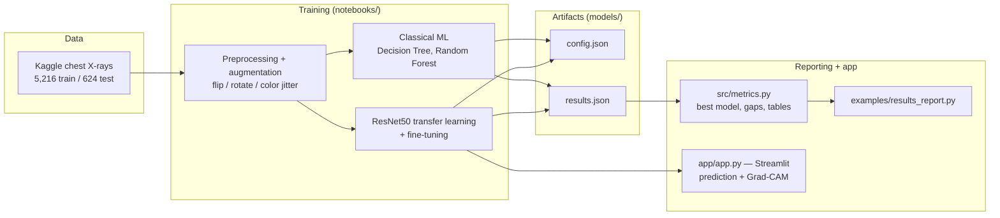

# Pneumonia Detection from Chest X-rays

Master's Final Project — DATA 6250 Machine Learning, Wentworth Institute of Technology

## Overview
Medical image classification system that detects pneumonia from chest X-ray images,
using both classical machine learning and deep learning approaches.

## Results

| Model | Accuracy | AUC-ROC |
|---|---|---|
| Decision Tree | 82.37% | — |
| Random Forest | 82.05% | 0.9499 |
| **ResNet50 CNN** | **91.67%** | **0.9627** |

Best model: ResNet50 fine-tuned with transfer learning.
Pneumonia recall: **97%** (catches 97% of all pneumonia cases).

## Dataset
- **Name:** Chest X-Ray Images (Pneumonia) — [Kaggle](https://www.kaggle.com/datasets/paultimothymooney/chest-xray-pneumonia) (CC BY 4.0)
- **Size:** 5,216 training images, 624 test images
- **Classes:** NORMAL (1,342) vs PNEUMONIA (3,876)

> Dataset not included (2.3 GB). Download from the Kaggle link and place in `data/raw/chest_xray/chest_xray/`.

## Architecture



## Project structure
```
├── app/            # Streamlit web app (app.py)
├── models/         # config.json, results.json, trained weights
├── notebooks/      # eda, preprocessing, baseline_cnn, transfer_learning, evaluation, classical_ml
├── src/            # result-reporting helpers (metrics.py)
├── tests/          # pytest unit tests for src/ and models/ artifacts
├── examples/       # runnable results-report demo
├── Makefile        # setup / test / report / app / clean shortcuts
├── .github/        # CI workflow (py_compile + pytest)
└── requirements.txt
```

## How to run
```bash
python3 -m venv venv && source venv/bin/activate
pip install -r requirements.txt
kaggle datasets download -d paultimothymooney/chest-xray-pneumonia
unzip chest-xray-pneumonia.zip -d data/raw/
jupyter notebook          # run notebooks/ in order
cd app && streamlit run app.py
```

## Methods
EDA, data augmentation (flip/rotate/color jitter), PyTorch DataLoaders with class
weighting, scratch CNN baseline, ResNet50 transfer learning + fine-tuning,
Decision Tree, Random Forest with GridSearchCV (36 fits, 3-fold CV), Grad-CAM
explainability, Streamlit deployment. Metrics: accuracy, precision, recall, F1,
AUC-ROC, confusion matrix.

*Random seeds:* classical models use `random_state=42`; PyTorch uses deterministic MPS on Apple Silicon.

## Tests and CI

```bash
pip install pytest
python -m pytest tests/ -q
```

The suite (26 tests) covers `src/metrics.py` (loading results/config,
best-model selection, accuracy gaps, markdown tables — 11 tests) and the
committed artifacts in `models/` (config shape and class mapping, dataset
sizes, results ranges, best-model checks, CV/best-params values — 15 tests),
so the numbers quoted in this README are checked on every run. GitHub
Actions runs `py_compile` plus the test suite on every push and pull
request to `main`.

## Make shortcuts

```bash
make setup    # create venv, install requirements + pytest
make test     # run the pytest suite
make report   # print the model-comparison report
make app      # launch the Streamlit app (needs trained weights)
make clean    # remove caches and the venv
```

## Examples

```bash
python examples/results_report.py
```

Prints a model-comparison report from the stored `models/results.json`:
best model by accuracy and by AUC, the best-vs-worst accuracy gap, and
the full markdown comparison table, using the helpers in `src/metrics.py`.

## FAQ / Troubleshooting

**The app fails to load the model — where are the weights?**
The trained weights (`models/best_resnet50.pth`) are not committed to the
repo. Train the model by running the notebooks in order, or place your own
checkpoint at that path; the app loads it in `load_model()` in `app/app.py`.

**Do the tests need the full torch stack?**
No. The test suite only exercises `src/metrics.py` and the JSON artifacts,
so CI installs pytest alone. The notebooks and the Streamlit app need the
full `requirements.txt` (torch, torchvision, grad-cam, streamlit).

**Why does the Decision Tree show "—" for AUC?**
The classical baseline reports accuracy only, so `results.json` stores a
null AUC for it and the report renders "—". The ResNet50 (0.9627) and
Random Forest (0.9499) rows do report AUC.

**Where does the dataset go?**
Download the Kaggle archive and unzip it under `data/raw/` so the paths in
`models/config.json` resolve (`data/raw/chest_xray/chest_xray/train|val|test`).

**`device` in `models/config.json` says `mps` — what if I have no Mac?**
Change it to `cpu` (or `cuda` on an NVIDIA GPU). The notebooks pick the
device from this config; the app itself falls back to CPU when MPS is
unavailable.
